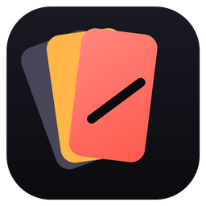

  

  
  
  
  
  

---

### ▸ Now shipping

<table>
  <tr>
    <td width="96" align="center"></td>
    <td>
      <b><a href="https://cutdeck.mohanbuilds.space">Cutdeck</a></b> · <i>Long videos in. Shorts out.</i> 
      Paste a YouTube, Kick or Twitch link. Cutdeck finds the moments worth posting, frames them vertical and adds word-by-word captions, all on your own computer. 
      <code>Rust</code> <code>Tauri</code> <code>React</code> <code>Whisper</code> <code>LLMs</code> <code>FFmpeg</code> · Windows · Free
    </td>
  </tr>
</table>

### ▸ Case files

| | Project | What it does | Built with |
|:-:|---|---|---|
| 🎬 | **Arclor** | An AI video director, in progress. Your coding agent writes the scenes; Arclor runs the whole film and checks every frame. | `TypeScript` `MCP` `Remotion` `AI agents` |
| 🧠 | **[Gito](https://github.com/Mohanyadav-codes/Gito---Github-repo-partner)** | Paste a GitHub link and talk to the codebase. Hybrid RAG over the code, chat UI and CLI. | `Python` `RAG` `React` |
| 👁️ | **[Vision Attendance](https://github.com/Mohanyadav-codes/Computer-Vision-AI-attendance-system)** | Face-recognition attendance that can't be fooled by someone walking past. | `Python` `OpenCV` `Flask` `React` |
| 🃏 | **[Jester AI](https://github.com/Mohanyadav-codes/Jester-AI)** | An agent that does dark work, in the funniest way possible. | `AI agents` `LLMs` |
| ⚡ | **[API Ninja](https://github.com/Mohanyadav-codes/API-Ninja)** | A fast, dark API testing client in the browser. | `React` `Tailwind` |

### ▸ The arsenal

**AI, the main weapon**

          

     

**Everything that gets it to people**

  
  
   
  
  

Plus GSAP, React Native, WebSockets and REST APIs.

### ▸ Off duty

🎧 Into music, a bit. 🎬 Making videos on [YouTube](https://www.youtube.com/@Mohan.Builds) about the things I build.

